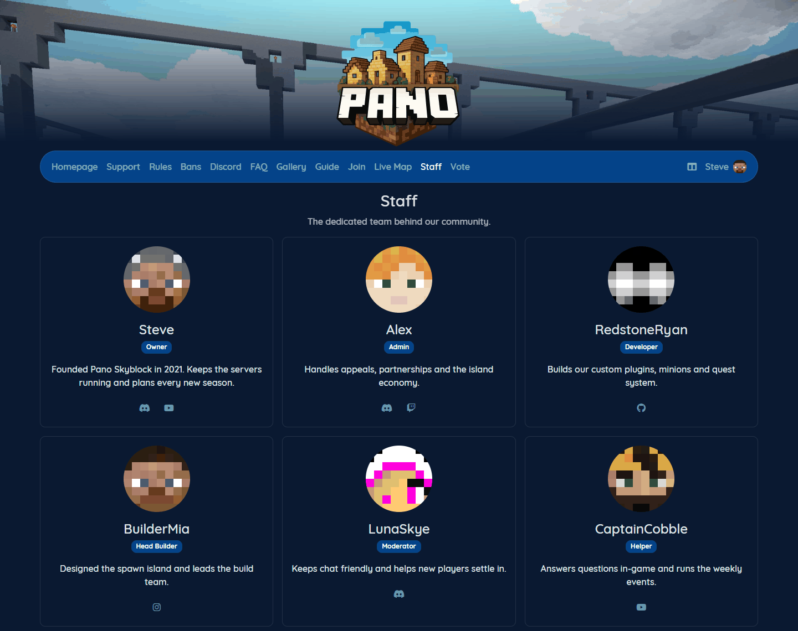
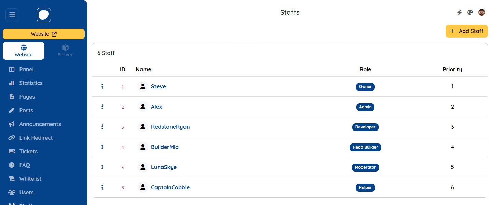

  
  <h1>Staff Page</h1>
  
<b>Show off the team that runs your server.</b>

  

    
    
    
  

Introduce the people behind your server. Staff Page gives your website a good-looking team page with each member's role, Minecraft head, a short bio and their social links. New players see who to ask for help, and your team gets the credit it deserves.

<h3 align="center">Features</h3>

- 👥 **Team page**: show your whole staff on one clean page.
- 🏷️ **Roles**: give everyone a role badge like Owner, Admin, Builder or Helper.
- 🧑 **Minecraft heads**: avatars come from each member's Minecraft name, or use your own image.
- ✍️ **Short bios**: tell players what each member does.
- 🔗 **Social links**: add Discord, YouTube, Twitch, X, Instagram or GitHub links with matching icons.
- 🔢 **Your order**: choose who appears first.
- 🎨 **Three layouts**: cards, list or grid, on its own page or in your Support section.

<h3 align="center">Screenshots</h3>

<i>Add, edit and order your team from the panel.</i>

<h3 align="center">Get started</h3>

1. Open your Pano panel and go to **Addons**.
2. Find **Staff Page** and click **Install**.
3. Open **Staffs** in your panel and click **Add Staff** to add your team.

<h3 align="center">Support</h3>

Questions or ideas? Join our [Discord](https://panomc.com/discord) or visit [panomc.com](https://panomc.com).

<h3 align="center">License</h3>

Released under the MIT License.
